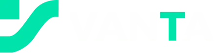
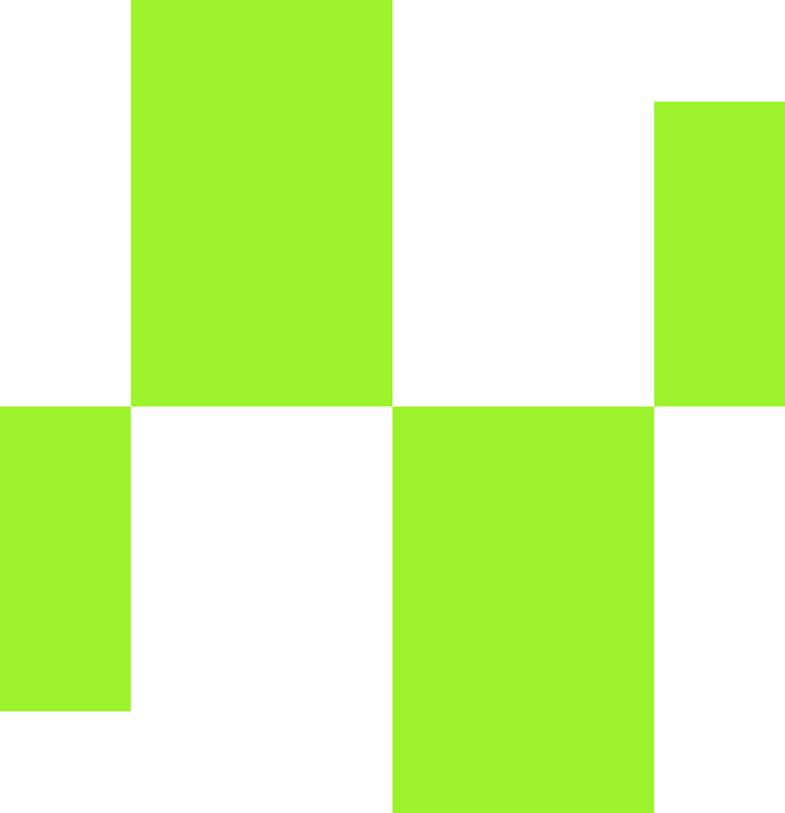
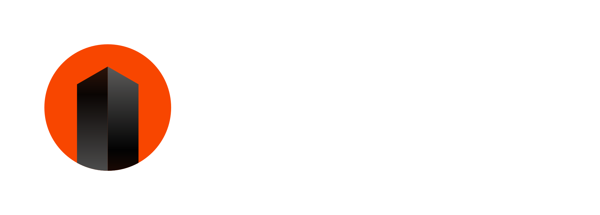
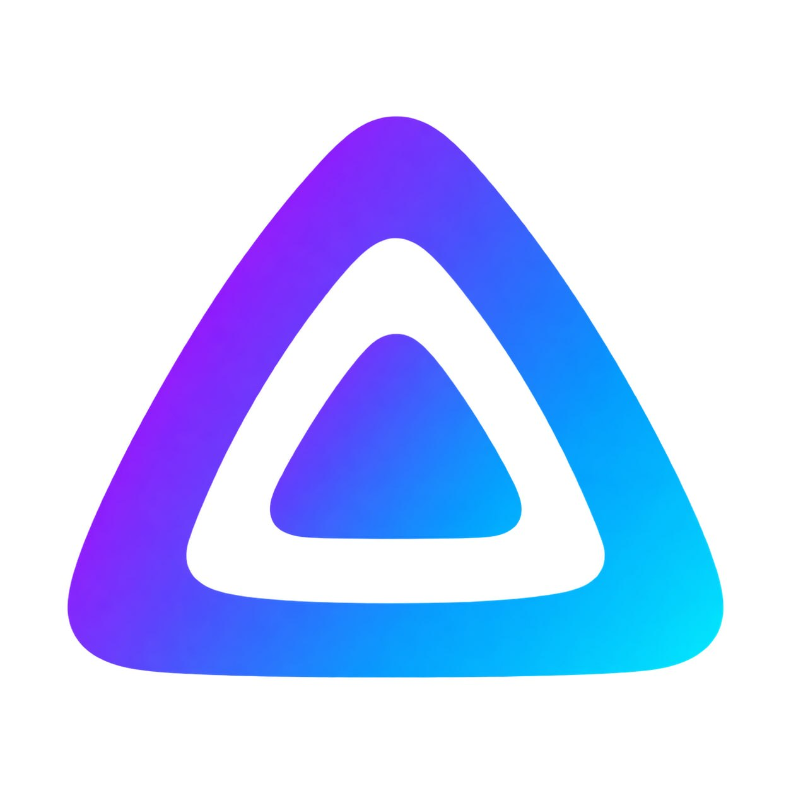
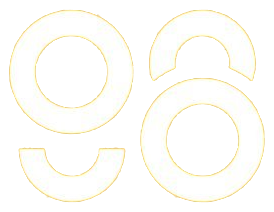

# Featured Builders

Explore the ecosystem of high-performance DEXs and trading platforms powered by Orderly Network.

<CardGroup cols={3}>
  <a
    className="featured-builder-card"
    href="https://app.vanta.exchange/"
    target="_blank"
    rel="noopener noreferrer"
    aria-label="Visit Vanta"
  >
    DIAMOND
    

      
    

    
      Vanta{" "}
      
        ↗
      
    
  </a>
  <a
    className="featured-builder-card"
    href="https://perps.raydium.io"
    target="_blank"
    rel="noopener noreferrer"
    aria-label="Visit Raydium"
  >
    DIAMOND
    

      
    

    
      Raydium{" "}
      
        ↗
      
    
  </a>
  <a
    className="featured-builder-card"
    href="https://rwaperp.xyz"
    target="_blank"
    rel="noopener noreferrer"
    aria-label="Visit RWAPerp"
  >
    DIAMOND
    

      
    

    
      RWAPerp{" "}
      
        ↗
      
    
  </a>
  <a
    className="featured-builder-card"
    href="https://pro.woofi.com"
    target="_blank"
    rel="noopener noreferrer"
    aria-label="Visit WOOFi Pro"
  >
    DIAMOND
    

      
    

    
      WOOFi Pro{" "}
      
        ↗
      
    
  </a>
  <a
    className="featured-builder-card"
    href="https://fillx.io"
    target="_blank"
    rel="noopener noreferrer"
    aria-label="Visit FillX"
  >
    DIAMOND
    

      
    

    
      FillX{" "}
      
        ↗
      
    
  </a>
  <a
    className="featured-builder-card"
    href="https://trade.what.exchange"
    target="_blank"
    rel="noopener noreferrer"
    aria-label="Visit what.exchange"
  >
    DIAMOND
    

      
    

    
      what.exchange{" "}
      
        ↗
      
    
  </a>
  <a
    className="featured-builder-card"
    href="https://app.aegisdex.io"
    target="_blank"
    rel="noopener noreferrer"
    aria-label="Visit AegisDEX"
  >
    DIAMOND
    

      
    

    
      AegisDEX{" "}
      
        ↗
      
    
  </a>
  <a
    className="featured-builder-card"
    href="https://arthurdex.com"
    target="_blank"
    rel="noopener noreferrer"
    aria-label="Visit Arthur"
  >
    DIAMOND
    

      
    

    
      Arthur{" "}
      
        ↗
      
    
  </a>
  <a
    className="featured-builder-card"
    href="https://dexless.exchange"
    target="_blank"
    rel="noopener noreferrer"
    aria-label="Visit DEXLESS"
  >
    DIAMOND
    

      
    

    
      DEXLESS{" "}
      
        ↗
      
    
  </a>
  <a
    className="featured-builder-card"
    href="https://dex.orderly.network/dex-mythos-93631969"
    target="_blank"
    rel="noopener noreferrer"
    aria-label="Visit Mythos"
  >
    DIAMOND
    

      Mythos
    

    
      Mythos{" "}
      
        ↗
      
    
  </a>
  <a
    className="featured-builder-card"
    href="https://obx.exchange"
    target="_blank"
    rel="noopener noreferrer"
    aria-label="Visit ORBITX"
  >
    DIAMOND
    

      
    

    
      ORBITX{" "}
      
        ↗
      
    
  </a>
  <a
    className="featured-builder-card"
    href="https://dex.orderly.network/dex-just-another-perp-3db723e4"
    target="_blank"
    rel="noopener noreferrer"
    aria-label="Visit Brownian"
  >
    PLATINUM
    

      Brownian
    

    
      Brownian{" "}
      
        ↗
      
    
  </a>
  <a
    className="featured-builder-card"
    href="https://dex.orderly.network/pudgy-dex-6810"
    target="_blank"
    rel="noopener noreferrer"
    aria-label="Visit Pudgy DEX"
  >
    PLATINUM
    

      
    

    
      Pudgy DEX{" "}
      
        ↗
      
    
  </a>
  <a
    className="featured-builder-card"
    href="https://app.throne.network"
    target="_blank"
    rel="noopener noreferrer"
    aria-label="Visit Throne"
  >
    PLATINUM
    

      
    

    
      Throne{" "}
      
        ↗
      
    
  </a>
  

    PLATINUM
    

      Trade Alpha
    

    Trade Alpha
  

  

    PLATINUM
    

      Velto
    

    Velto
  

  <a
    className="featured-builder-card"
    href="https://app.alpix.io"
    target="_blank"
    rel="noopener noreferrer"
    aria-label="Visit Alpix"
  >
    GOLD
    

      
    

    
      Alpix{" "}
      
        ↗
      
    
  </a>
  <a
    className="featured-builder-card"
    href="https://perps.pangolin.exchange"
    target="_blank"
    rel="noopener noreferrer"
    aria-label="Visit Pangolin"
  >
    GOLD
    

      
    

    
      Pangolin{" "}
      
        ↗
      
    
  </a>
  

    GOLD
    

      Xnet
    

    Xnet
  

  <a
    className="featured-builder-card"
    href="https://alphaprimer.com/"
    target="_blank"
    rel="noopener noreferrer"
    aria-label="Visit AlphaPrimer"
  >
    GOLD
    

      
    

    
      AlphaPrimer{" "}
      
        ↗
      
    
  </a>
  <a
    className="featured-builder-card"
    href="https://coin98.com"
    target="_blank"
    rel="noopener noreferrer"
    aria-label="Visit Coin98"
  >
    GOLD
    

      
    

    
      Coin98{" "}
      
        ↗
      
    
  </a>
  

    GOLD
    

      DeltaPulse
    

    DeltaPulse
  

  

    GOLD
    

      DEXUS
    

    DEXUS
  

  <a
    className="featured-builder-card"
    href="https://app.foxify.trade"
    target="_blank"
    rel="noopener noreferrer"
    aria-label="Visit FOXIFY"
  >
    GOLD
    

      
    

    
      FOXIFY{" "}
      
        ↗
      
    
  </a>
  

    GOLD
    

      Nexus Trading Labs
    

    Nexus Trading Labs
  

  <a
    className="featured-builder-card"
    href="https://app.oxbit.exchange"
    target="_blank"
    rel="noopener noreferrer"
    aria-label="Visit OxBit"
  >
    GOLD
    

      
    

    
      OxBit{" "}
      
        ↗
      
    
  </a>
  

    GOLD
    

      Perphaus
    

    Perphaus
  

  

    GOLD
    

      Rico Soro
    

    Rico Soro
  

  <a
    className="featured-builder-card"
    href="https://www.sigmamarkets.xyz"
    target="_blank"
    rel="noopener noreferrer"
    aria-label="Visit Sigma Markets"
  >
    GOLD
    

      
    

    
      Sigma Markets{" "}
      
        ↗
      
    
  </a>
  

    GOLD
    

      TakoDex
    

    TakoDex
  

  

    GOLD
    

      TickerWar
    

    TickerWar
  

  

    GOLD
    

      tradev
    

    tradev
  

</CardGroup>

---

# Start building on Orderly

Ready to launch your own trading platform? Join the ecosystem and leverage Orderly's omnichain infrastructure to scale your business.

### Why become a Builder?

- **Immediate liquidity:** Tap into a shared orderbook without the need for bootstrapping.
- **Revenue autonomy:** Define your own fee structure and keep **100% of the margin** above base fees.
- **Builder Staking Program benefits:** Stake \$ORDER or grow your volume to lower your base fees and unlock dedicated support.

**[Become a Builder today →](/introduction/getting-started/builder-onboarding)**

---
