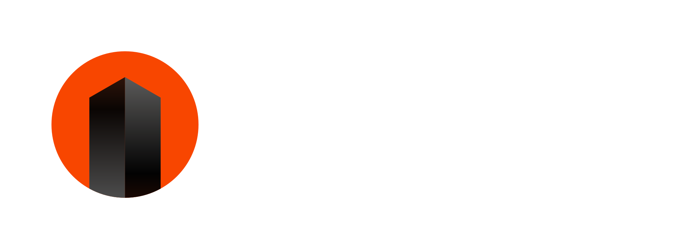

# Featured Builders

Explore the ecosystem of high-performance DEXs and trading platforms powered by Orderly Network.

<CardGroup cols={3}>
  <a
    className="featured-builder-card"
    href="https://dexless.exchange"
    target="_blank"
    rel="noopener noreferrer"
    aria-label="Visit DEXLESS"
  >
    DIAMOND
    

      
    

    
      DEXLESS{" "}
      
        ↗
      
    
  </a>
  <a
    className="featured-builder-card"
    href="https://perps.raydium.io"
    target="_blank"
    rel="noopener noreferrer"
    aria-label="Visit Raydium"
  >
    DIAMOND
    

      
    

    
      Raydium{" "}
      
        ↗
      
    
  </a>
  <a
    className="featured-builder-card"
    href="https://dex.orderly.network/pudgy-dex-6810"
    target="_blank"
    rel="noopener noreferrer"
    aria-label="Visit Pudgy DEX"
  >
    PLATINUM
    

      
    

    
      Pudgy DEX{" "}
      
        ↗
      
    
  </a>
  <a
    className="featured-builder-card"
    href="https://pro.woofi.com"
    target="_blank"
    rel="noopener noreferrer"
    aria-label="Visit WOOFi Pro"
  >
    PLATINUM
    

      
    

    
      WOOFi Pro{" "}
      
        ↗
      
    
  </a>
  <a
    className="featured-builder-card"
    href="https://app.alpix.io"
    target="_blank"
    rel="noopener noreferrer"
    aria-label="Visit Alpix"
  >
    GOLD
    

      
    

    
      Alpix{" "}
      
        ↗
      
    
  </a>
  <a
    className="featured-builder-card"
    href="https://dex.orderly.network/dex-mythos-93631969"
    target="_blank"
    rel="noopener noreferrer"
    aria-label="Visit Mythos"
  >
    GOLD
    

      Mythos
    

    
      Mythos{" "}
      
        ↗
      
    
  </a>
  <a
    className="featured-builder-card"
    href="https://rwaperp.xyz"
    target="_blank"
    rel="noopener noreferrer"
    aria-label="Visit RWAPerp"
  >
    GOLD
    

      
    

    
      RWAPerp{" "}
      
        ↗
      
    
  </a>
  <a
    className="featured-builder-card"
    href="https://app.vanta.exchange/"
    target="_blank"
    rel="noopener noreferrer"
    aria-label="Visit Vanta"
  >
    GOLD
    

      
    

    
      Vanta{" "}
      
        ↗
      
    
  </a>
</CardGroup>

---

# Start building on Orderly

Ready to launch your own trading platform? Join the ecosystem and leverage Orderly's omnichain infrastructure to scale your business.

### Why become a Builder?

- **Immediate liquidity:** Tap into a shared orderbook without the need for bootstrapping.
- **Revenue autonomy:** Define your own fee structure and keep **100% of the margin** above base fees.
- **Builder Staking Program benefits:** Stake \$ORDER or grow your volume to lower your base fees and unlock dedicated support.

**[Become a Builder today →](/introduction/getting-started/builder-onboarding)**

---
